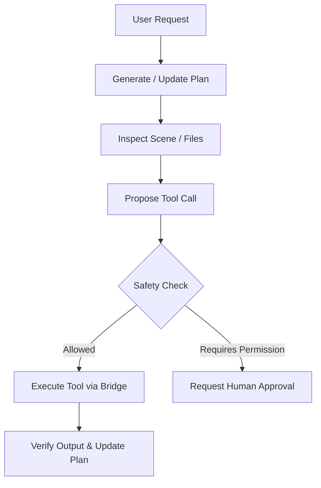

# Agent Manual & Collaboration Protocol

Forge provides autonomous AI agents with structured tools, live scene introspection, and deterministic project indexes.

---

## 1. Prime Directives for AI Agents

1. **Exact Names:** Always use exact tool and component names (`scene.set_component`, not `update_component`).
2. **Short Factual Reasoning:** Keep thought traces concise. Explain invariants and concrete steps.
3. **Validate Before Execution:** Run `script.check` or `forge check` before committing script edits.
4. **Inspect State First:** Query scene hierarchy via `scene.get_tree` or check `.forge/map.json` before mutating entities.
5. **No Filler:** Never output conversational filler or unnecessary explanations when tool results suffice.

---

## 2. Tool Execution Workflow

---

## 3. Handling Errors

When a tool returns an error code:
- Check the [Error Catalog](file:///docs/src/reference/errors/index.md).
- Do not repeat the identical failed call without changing arguments.
- If error is `-32001 (Unauthorized)`, verify the security token from `.forge/bridge.json`.
- If error is `-32602 (Invalid Params)`, verify the JSON argument schema.
